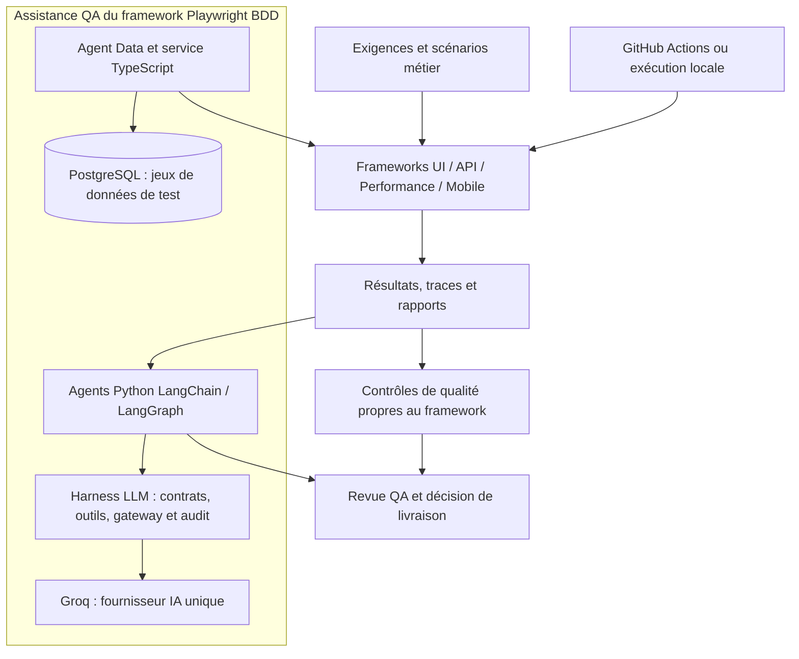

# QA Platform — Unified Quality Engineering

Plateforme de tests automatisés UI, API, performance et mobile, avec rapports Allure, intégration GitHub Actions et agents IA d'assistance QA.

**Version publiée : [v1.7.1](https://github.com/Faicel-Testing/qa-plateforme/releases/tag/v1.7.1)** — [évolutions du framework Playwright BDD](ui_playwright_bdd/CHANGELOG.md).

## Objectif

Ce dépôt regroupe plusieurs frameworks pour organiser les scénarios métier, exécuter les tests et conserver les preuves nécessaires à leur analyse. Les agents IA assistent la génération et le diagnostic ; les résultats d'exécution et la validation humaine restent les références pour décider d'une livraison.

Les frameworks partagent une approche BDD et des pratiques QA, avec des dépendances, commandes et workflows propres à chaque projet. Les capacités LangChain, Groq et PostgreSQL décrites ci-dessous concernent le framework Playwright BDD.

## Frameworks du dépôt

| Projet | Stack principale | Documentation |
| --- | --- | --- |
| UI Playwright BDD | Playwright, CucumberJS, TypeScript ; agents Python LangChain / LangGraph | [Guide Playwright](ui_playwright_bdd/README.md) |
| API pytest | Python, pytest-bdd, Requests | [Guide API Python](api-pytest-framework/README.md) |
| API RestAssured | Java, Cucumber, RestAssured | [Guide API Java](api-Java-Rest-Assured/README.md) |
| UI Selenium BDD | Java, Selenium, Cucumber | [Guide Selenium](ui_selenium_bdd/README.md) |
| UI Cypress BDD | JavaScript, Cypress, Cucumber | [Guide Cypress](ui_cypress_bdd/README.md) |
| Performance k6 | JavaScript, k6 ; scénarios smoke, load et stress | [Guide performance](perf_k6_qacart/README.md) |
| Mobile | Java, Appium, TestNG | [Projet mobile](mobile/) |

## Architecture générale



## Playwright BDD — évolutions depuis la version 1.7.1

- **Moteur BDD unique** : CucumberJS pilote les scénarios ; Playwright fournit les navigateurs et assertions. Les formulaires utilisent des sélecteurs stables et les tests de tâches invalides vérifient le message de validation et l'absence d'insertion.
- **Retries et runs isolés** : tentatives comptées par scénario, distinction entre diagnostic et retry réellement démarré, résultats multibrowser identifiés par manifeste et fusion limitée aux runs terminés.
- **RAG hybride local** : BM25 et embeddings multilingues E5, stockage fichier ou PostgreSQL avec pgvector, puis reranking Groq optionnel. La base documentaire reste distincte des jeux de données de test.
- **Observabilité optionnelle** : Langfuse auto-hébergé et OpenTelemetry relient les étapes Python et Node, avec durées, statuts et compteurs disponibles. Les secrets et contenus bruts des preuves restent hors des traces.
- **Diagnostics explicites** : erreurs de données, de quota Groq et exécutions incomplètes restent visibles ; une analyse IA indisponible ne devient pas un succès de test.

Ces changements concernent le code courant ; le lien de release ci-dessus reste celui de la dernière version publiée.

## Capacités du framework Playwright BDD

- **Orchestration Python** : LangGraph pilote l'exécution, la validation des résultats, le triage et le diagnostic ; LangChain et Pydantic structurent les échanges IA.
- **Harness LLM** : outils autorisés, propositions de modifications à revoir, gateway Groq, budgets, cache, circuit breaker et métriques.
- **Données de test PostgreSQL** : profils synthétiques générés en SQL, réservations par scénario et consultation avec pgAdmin. La base de jeux de test est distincte de celle de l'application.
- **RAG et évaluation** : recherche BM25 ou hybride avec embeddings locaux, stockage pgvector optionnel, reranking Groq configurable et évaluations DeepEval à la demande.
- **Traçabilité** : résultats Allure isolés par run, environnement, historique et tendances ; captures et traces pour investiguer les échecs.
- **Intégrations** : backlog Plane et contexte documentaire Confluence, selon configuration et autorisations.

## Démarrer avec Playwright BDD

Prérequis : Node.js 24, Python 3.12 pour les agents et Java pour Allure. Les commandes suivantes sont destinées à PowerShell.

```powershell
git clone https://github.com/Faicel-Testing/qa-plateforme.git
cd qa-plateforme/ui_playwright_bdd
npm.cmd ci
npx.cmd playwright install chromium
Copy-Item .env.example .env
npm.cmd run agents:setup
npm.cmd run agents:doctor
```

Configurer `.env` localement : URL de l'application et clé `GROQ_API_KEY` pour les appels IA. Pour une installation déjà configurée, conserver le fichier `.env` existant.

```powershell
# Smoke sans appel LLM
npm.cmd run agents:pipeline -- quick --local-only
# Suite complète, triage et diagnostic IA des échecs
npm.cmd run agents:pipeline -- full
# Générer puis ouvrir Allure après le run
npm.cmd run allure:generate
npm.cmd run allure:open
```

Voir le [README Playwright](ui_playwright_bdd/README.md) pour l'agent Data, PostgreSQL, l'analyse d'un run et DeepEval.

Le mode de données par défaut est `memory`. Le mode `postgres` nécessite une base accessible et échoue explicitement si elle est arrêtée. Pour le contexte documentaire et les traces IA, consulter les guides [RAG pgvector](ui_playwright_bdd/docs/rag-pgvector.md) et [Langfuse](ui_playwright_bdd/docs/observability-langfuse.md).

Validation ciblée du 26 octobre 2026 : TypeScript et ESLint passent, ainsi que 56 tests Node ciblés, 70 contrôles de revue/orchestration et 62 tests Python. Le dry-run résout 29 scénarios Gherkin. L'inscription et la connexion passent dans Chromium avec les données en mémoire. Cela ne constitue pas une validation de la régression UI complète ni du mode PostgreSQL.

## CI/CD et qualité

Les workflows sont versionnés dans [.github/workflows](.github/workflows/). Leurs déclencheurs et contrôles diffèrent selon le framework.

Le [workflow Playwright](.github/workflows/ci-playwright.yml) exécute l'installation, ESLint, TypeScript, les contrôles de revue et d'orchestration, puis les scénarios `@regression` en Chromium headless. Il est déclenché sur les changements concernés vers `main`, les pull requests, manuellement et le dimanche à 08:00 UTC. Les rapports Allure et les preuves d'exécution sont conservés en artefacts ; une étape distincte prend en charge l'analyse IA.

Un rapport disponible ou une réponse IA ne suffit pas à autoriser une livraison. Le gate Python exige une exécution complète et tous les tests sélectionnés réussis ; l'autorisation de release reste séparée.

## Configuration et limites

Les clés, fichiers `.env`, bases locales et journaux d'exécution restent locaux ou dans les mécanismes de secrets du CI. Chaque intégration nécessite ses propres droits d'accès. Groq est soumis aux quotas du compte ; Confluence peut être exclu du contexte lorsque l'accès est indisponible.

Les tâches suivent une règle cible de 1 à 200 caractères après suppression des espaces en début et fin. Les divergences connues de l'application de démonstration restent signalées par les tests ; un message de validation seul ne suffit pas si une tâche invalide est enregistrée. Consulter la [règle cible et les constats](ui_playwright_bdd/docs/todo-validation.md) et les [notes de version](ui_playwright_bdd/CHANGELOG.md).

## Auteur

**Faicel Ghanem — QA Automation Architect · Freelance**

Architecture QA, automatisation UI / API / mobile, CI/CD, quality gates et agents IA.

[Email](mailto:faicel.ganem@gmail.com) · [LinkedIn](https://www.linkedin.com/in/ghanem-faicel-b40787a8/) · [Malt](https://www.malt.fr/profile/faicelghanem)

Ce dépôt présente une architecture QA et ses implémentations de démonstration. Les implémentations client sont maintenues dans des dépôts privés.
