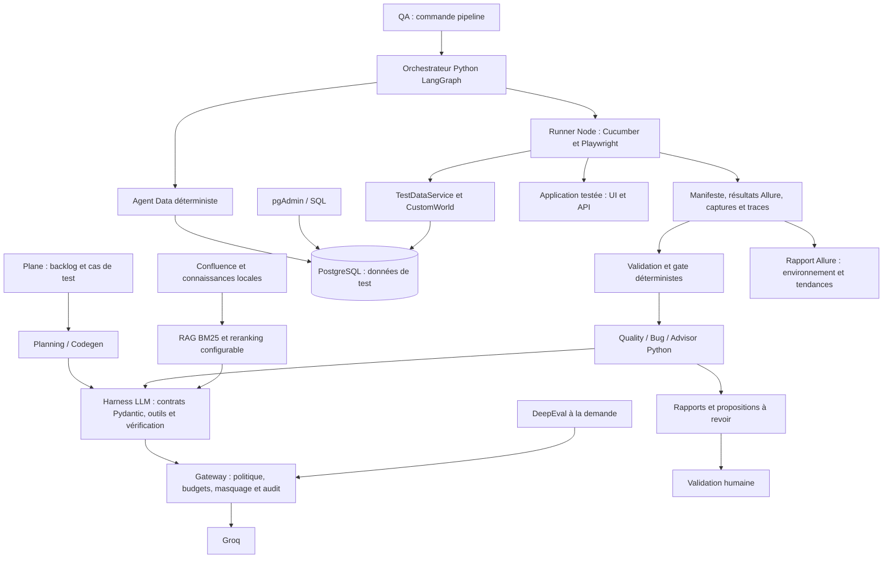

# Playwright BDD — Framework QA avec agents IA

**Version 1.7.0** · [Notes de version](CHANGELOG.md) · [Plateforme QA](../README.md)

Tests BDD en **Playwright, CucumberJS et TypeScript**, assistés par des agents Python **LangChain / LangGraph**. Le framework exécute les scénarios, conserve les preuves Allure, analyse les échecs et prépare des propositions de code soumises à revue humaine.

**Configuration IA actuelle : Groq uniquement**, recherche RAG BM25 et reranking Groq configurable. PostgreSQL est disponible pour les jeux de données de test ; les générateurs en mémoire restent le mode par défaut de `.env.example`.

## Architecture



Le graphe présente les composants disponibles. Le pipeline Python `full` prépare les données si PostgreSQL est activé, exécute les tests, valide les preuves et analyse les échecs. Planning, Codegen, DeepEval et les synchronisations externes disposent de commandes séparées.

## Prérequis et installation

| Composant | Usage |
| --- | --- |
| Node.js 24 et npm | Tests TypeScript, outils Node et contrôles CI ; version dans [.nvmrc](.nvmrc) |
| Python 3.12 | Agents LangChain / LangGraph dans `.venv-agents` |
| Navigateurs Playwright | Chromium pour le démarrage et la CI ; Firefox disponible selon configuration |
| Java accessible dans le PATH | Génération et ouverture des rapports Allure |
| Clé Groq | Analyses IA, génération, reranking et juge DeepEval |
| PostgreSQL / pgAdmin | Optionnels, pour le mode de données `postgres` |

Depuis le dossier `ui_playwright_bdd`, dans PowerShell :

```powershell
npm.cmd ci
npx.cmd playwright install chromium
# Nouvelle installation seulement : conserver un .env déjà configuré
Copy-Item .env.example .env
npm.cmd run agents:setup
npm.cmd run agents:doctor
```

Renseigner les paramètres dans `.env`, sans publier ce fichier. Les tests peuvent s'exécuter sans LLM ; les commandes IA nécessitent une clé valide. Les environnements Python des agents et de DeepEval sont distincts.

## Commandes quotidiennes

```powershell
# Voir le plan sans lancer les tests
npm.cmd run agents:pipeline -- full --dry-run
# Smoke @smoke sans appel au modèle
npm.cmd run agents:pipeline -- quick --local-only
# Suite complète, triage et diagnostic des échecs
npm.cmd run agents:pipeline -- full --max-failures 10
# Tests Cucumber directs sans orchestration IA
npm.cmd run test:headless
# Générer le rapport du run puis l'ouvrir
npm.cmd run allure:generate
npm.cmd run allure:open
```

`quick` sélectionne `@smoke` et se limite au triage ; `full` ajoute le diagnostic. Les deux modes Python exécutent le navigateur en headless. Le timeout du runner vaut 1 800 secondes par défaut et se règle avec `--runner-timeout`.

Le pipeline Python `agents:pipeline` et le pipeline JavaScript historique `agent:pipeline:*` ont des périmètres différents. Le pipeline Python ne génère pas de sources et ne déclenche aucune publication Git ou synchronisation Plane. Voir le [guide Python](docs/python-agents.md).

## Agents et responsabilités

| Capacité | Implémentation et rôle |
| --- | --- |
| Pipeline | LangGraph : préparation des données, exécution, validation, analyse et rapport |
| Planning | Lecture du backlog Plane et préparation du contexte de génération |
| Codegen | Graphe Python : propositions Gherkin, steps et Page Objects, avec contrôles syntaxiques |
| Quality | Triage et diagnostic structurés avec LangChain et Pydantic |
| Bug | Investigation par lecture des sources ; proposition de correctif à revoir |
| Advisor | Gate déterministe et explication IA optionnelle |
| Data | Préparation et suivi des données PostgreSQL ; SQL et service TypeScript, sans LLM |
| Runner | Adaptateur Node : exécution réelle Cucumber / Playwright et manifeste du run |
| Reporting / Allure | Rapports HTML, environnement, historique et tendances |
| Observabilité | Durées, appels, tokens, estimations de coûts et état du circuit breaker |
| CI / gouvernance / revue | Adaptateurs existants pour GitHub Actions et les étapes de validation |

Le **harness LLM** regroupe les contrats de sortie, les outils autorisés, les limites d'itération, la lecture des preuves, les vérificateurs et la passerelle d'accès au modèle. Une analyse cohérente reste une hypothèse tant que sa cause n'est pas démontrée par une reproduction.

## Analyser un échec et proposer un correctif

Chaque run d'agent possède un dossier `allure-runs/<runId>/`. Remplacer `ID` ci-dessous par l'identifiant indiqué par le runner ; le dossier et le manifeste doivent correspondre.

```powershell
# Réanalyser un run existant
npm.cmd run agents:pipeline -- report --results-dir allure-runs/ID/results --run-id ID
# Investiguer avec lecture des sources
npm.cmd run agents:bug -- analyze --results-dir allure-runs/ID/results --run-id ID
# Préparer une proposition de réparation à revoir
npm.cmd run agents:bug -- repair --results-dir allure-runs/ID/results --run-id ID --max-iter 5
```

`repair` enregistre une proposition et conserve `fix_applied=false`. L'application d'un patch passe par le mécanisme de revue décrit dans [CI et validation humaine](docs/ci-human-review.md). Une erreur de fournisseur ou une analyse incomplète reste signalée comme telle.

Le gate Python exige un runner terminé, un code de sortie zéro, des résultats valides appartenant au run et tous les tests sélectionnés réussis. Les réponses IA ne modifient pas ce verdict. `release_authorization` reste `NOT_EVALUATED` : le gate de tests ne vaut pas autorisation de livraison.

## Agent Data, PostgreSQL et pgAdmin

La base dédiée contient des **jeux de données de test**, distincts des données internes de l'application. Les migrations créent `test_runs`, `data_sets` et `data_allocations`. Le seed SQL prépare 200 profils synthétiques et 3 cas négatifs.

```powershell
# Windows avec PostgreSQL installé : créer ou démarrer l'instance dédiée
npm.cmd run data:setup
# Initialiser schéma et données
npm.cmd run data:init
npm.cmd run agents:data -- status
# Vérifier les réservations concurrentes avec la base configurée
npm.cmd run data:test
```

Le script local utilise `127.0.0.1:5433`, la base `qa_test_data` et le rôle applicatif `qa_data`. Il configure les paramètres `TEST_DATA_PG*` et le mode `TEST_DATA_PROVIDER=postgres` dans `.env`. Pour une base existante, renseigner ces paramètres localement avant `data:init`.

Dans pgAdmin, utiliser le Query Tool avec [seed.sql](database/queries/seed.sql) et [inspect.sql](database/queries/inspect.sql). Le script `python scripts/register-data-pgadmin.py` permet d'enregistrer la connexion locale préparée par `data:setup`.

Les réservations sont isolées par scénario avec transactions et `FOR UPDATE SKIP LOCKED`. Les hooks libèrent leurs allocations ; le pipeline clôture le run après un runner terminé. Cette libération ne supprime pas les comptes créés dans l'application. En mode `postgres`, une indisponibilité de la base provoque un échec explicite. Voir le [guide Data PostgreSQL](docs/test-data-postgresql.md).

## Configuration

| Paramètre | Rôle |
| --- | --- |
| `BASE_URL` | URL de l'application testée |
| `TEST_HEADLESS`, `TEST_BROWSER` | Configuration navigateur réellement lue par les tests ; valeurs par défaut : `true` et `chromium` |
| `GROQ_API_KEY`, `GROQ_MODEL` | Accès IA ; modèle par défaut de l'exemple : `openai/gpt-oss-120b` |
| `RAG_ENABLED`, `RAG_MODE` | Recherche de contexte ; mode courant : `bm25` |
| `RAG_RERANK_ENABLED`, `RAG_RERANK_MODEL` | Reranking via Groq, configurable |
| `TEST_DATA_PROVIDER` | `memory` par défaut dans l'exemple ; `postgres` pour la base dédiée |
| `TEST_DATA_PGHOST`, `TEST_DATA_PGPORT`, `TEST_DATA_PGDATABASE`, `TEST_DATA_PGUSER`, `TEST_DATA_PGPASSWORD` | Connexion à la base de jeux de test |
| `PLANE_WORKSPACE`, `PLANE_PROJECT_ID`, `PLANE_API_KEY` | Intégration backlog Plane |
| `CONFLUENCE_RAG_ENABLED`, `CONFLUENCE_EMAIL`, `CONFLUENCE_API_TOKEN` | Contexte Confluence optionnel ; pages dans `config/confluence-rag.json` |
| `NODE_EXTRA_CA_CERTS` | Autorités de certification approuvées, si nécessaires au réseau d'entreprise |

Voir [.env.example](.env.example). Adapter les identifiants Plane et les pages Confluence à l'environnement cible. Les clés restent dans `.env` ou les secrets CI. La vérification TLS doit rester activée pour les transports IA.

## RAG, Groq et DeepEval

Le RAG recherche dans les connaissances disponibles avec BM25, puis peut reclasser les extraits avec Groq. Aucun service d'embeddings local n'est requis. Une indisponibilité Groq produit une erreur explicite ; le framework ne bascule pas vers un autre fournisseur. Le cache et le circuit breaker restent présents.

```powershell
npm.cmd run rag:index
npm.cmd run rag:status
npm.cmd run confluence:status
# Synchronisation explicite, avec compte Confluence autorisé
npm.cmd run confluence:sync
# Installer et vérifier l'environnement DeepEval séparé
npm.cmd run eval:setup
npm.cmd run eval:deepeval:check
npm.cmd run eval:deepeval -- --limit 1
npm.cmd run metrics:report
```

DeepEval mesure notamment la fidélité au contexte et la pertinence des réponses à l'aide d'un juge Groq. Il est lancé à la demande et ne s'exécute pas automatiquement après chaque test. Une erreur technique ne devient pas un score valide ; les scores ne garantissent pas la vérité métier.

La gateway contrôle les origines, modèles, tailles, délais et budgets d'appels. Elle masque certains contenus sensibles et journalise les décisions d'accès ; ces contrôles ne constituent pas une garantie exhaustive de confidentialité. Les extraits de sources nécessaires à une analyse peuvent être transmis à Groq : valider ce périmètre avant une intégration client. Voir [la gateway](docs/ai-gateway.md), [Groq uniquement](docs/groq-only.md) et [DeepEval](docs/deepeval.md).

## Rapports et diagnostic

| Emplacement | Contenu |
| --- | --- |
| `allure-runs/<runId>/results/` | Résultats et pièces jointes du run |
| `allure-runs/<runId>/results/run-manifest.json` | Identité, période et état de fin de l'exécution |
| `allure-runs/<runId>/runner.log` | Journal détaillé du runner |
| `allure-runs/<runId>/report/` | Rapport HTML généré par Allure |
| `logs/python-pipeline/<uuid>/summary.json` | Bilan du pipeline Python et gate |
| `logs/` | Journaux locaux, vérifications et métriques |

`allure:open` sélectionne les résultats selon le mécanisme de run du framework et génère le HTML s'il manque. Un `ALLURE_RESULTS_DIR` explicite permet de choisir un dossier. L'environnement est produit à la génération ; les tendances nécessitent un historique compatible, conservé localement ou restauré par la CI. Un rapport partiel ne prouve pas que le run a terminé.

Voir [Allure : historique et tendances](docs/allure-trends.md), [environnement](docs/allure-environment.md) et [diagnostics API](docs/api-failure-diagnostics.md).

## Qualité et CI/CD

```powershell
npm.cmd run lint
npm.cmd run typecheck
npm.cmd run test:review
npm.cmd run agents:test
```

Le [workflow GitHub Actions](../.github/workflows/ci-playwright.yml) utilise Node.js 24 et Chromium headless. Il exécute lint, TypeScript, les contrôles de revue et d'orchestration puis `@regression`. Allure, captures et traces sont publiés en artefacts. Une analyse IA distincte utilise la clé Groq configurée dans les secrets GitHub.

Déclencheurs : push et pull request vers `main` sur les chemins concernés, lancement manuel et dimanche à 08:00 UTC. PostgreSQL reste optionnel : une nouvelle installation utilise le mode `memory` tant qu'elle n'est pas configurée autrement.

## Structure du projet

```text
src/
  features/       Scénarios Gherkin
  steps/          Step definitions TypeScript
  pages/          Page Objects Playwright
  api/            Client API et diagnostics
  core/           CustomWorld et état du scénario
  hooks/          Cycle de vie, preuves et libération des données
  data/           Réservations PostgreSQL et TestDataService
  config/         Configuration d'exécution et des données
qa_agents/        Agents Python, graphes LangGraph et contrats Pydantic
scripts/          Lanceurs, adaptateurs Node et outils d'intégration
config/           Politique gateway, tarifs et sélection Confluence
database/         Migrations et requêtes SQL
evaluation/       Dataset et intégration DeepEval
prompts/          Prompts versionnés
skills/           Instructions spécialisées des agents
qa-knowledge/     Connaissances pour le RAG
docs/             Guides et stratégie de test
```

## Limites connues et documentation

La version 1.7.0 conserve un échec sur la longueur des tâches : l'application accepte 201 caractères avec HTTP 201, tandis que le scénario attend un rejet au-delà de la limite proposée de 200. La règle métier doit être confirmée ; l'assertion reste active. Voir le [diagnostic des correctifs login et du scénario Todo](docs/framework-login-fixes.md).

L'accès Confluence dépend des droits du compte ; un contexte indisponible est exclu. Les appels Groq restent soumis aux quotas et limites du fournisseur. Les jeux PostgreSQL ne couvrent pas encore toutes les valeurs négatives présentes dans les steps.

| Sujet | Guide |
| --- | --- |
| Stratégie de test | [TEST_STRATEGY.md](docs/TEST_STRATEGY.md) |
| Agents Python et commandes détaillées | [python-agents.md](docs/python-agents.md) |
| Revue humaine et CI | [ci-human-review.md](docs/ci-human-review.md) |
| Données SQL et pgAdmin | [test-data-postgresql.md](docs/test-data-postgresql.md) |
| Intégration Plane | [plane-integration.md](docs/plane-integration.md) |
| Accès Confluence | [confluence-access.md](docs/confluence-access.md) |
| RAG | [rag.md](docs/rag.md) |
| Vérification des agents | [agent-verification.md](docs/agent-verification.md) |
| Conventions et adaptateurs historiques | [agents.md](agents.md) |
