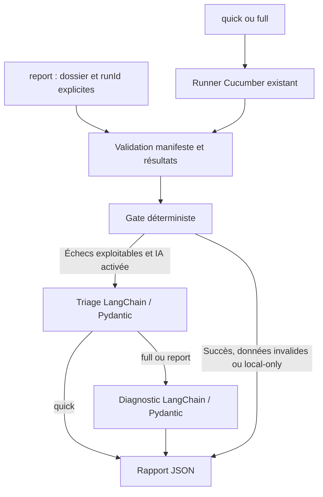

# Migration Python : LangChain et LangGraph

La couche `qa_agents` contient un orchestrateur global LangGraph natif et des
contrats Pydantic partagés par le pipeline, `quality`, `bug` et `advisor`.
La validation des résultats et le calcul du gate restent indépendants du modèle.
Les tests Playwright/Cucumber restent en TypeScript. Le backlog existant reste Plane.

## Installation et commandes

Depuis `ui_playwright_bdd`, avec Python 3.12 et les dépendances Node du projet :

```powershell
npm.cmd run agents:setup
npm.cmd run agents:doctor
npm.cmd run agents:test
npm.cmd run agents:pipeline -- quick --dry-run
```

`agents:setup` crée `.venv-agents` et installe `qa_agents/requirements.lock.txt`.
Le verrou contient les versions exactes de l'environnement local validé ; une
installation neuve sur une autre plateforme reste à vérifier. Les clés et les
certificats restent configurés via le `.env` et la passerelle existants.

Exécuter les tests sans appeler de modèle :

```powershell
npm.cmd run agents:pipeline -- quick --local-only
```

Exécuter les tests puis analyser les échecs avec le fournisseur IA configuré :

```powershell
npm.cmd run agents:pipeline -- full --max-failures 10
```

Le lanceur affiche son démarrage puis le chargement de LangGraph. Chaque étape du
pipeline annonce son activité. Pendant les tests, un message toutes les 15 secondes
indique le temps écoulé ; il ne constitue pas un verdict. Le journal détaillé est
`allure-runs/<runId>/runner.log`, dont le chemin est affiché avant l'exécution.
Ces messages sont disponibles pour les nouveaux processus lancés après la mise à jour.

Ces commandes exécutent réellement l'application cible. `quick` sélectionne
`@smoke` et effectue seulement le triage ; `full` lance la suite puis ajoute le
diagnostic. Les deux passent en headless. Le délai runner est de 1800 secondes,
réglable avec `--runner-timeout`. Aucune synchronisation Plane n'est déclenchée,
même si `PLANE_SYNC_RESULTS=true` existe dans l'environnement.

Analyser explicitement un run existant :

```powershell
npm.cmd run agents:pipeline -- report --results-dir allure-runs/ID/results --run-id ID --local-only
```

Remplacer `ID` par le `runId` du manifeste. Aucun choix implicite du « dernier »
résultat : le dossier et l'identifiant doivent correspondre. Les rapports sont
écrits séparément sous `logs/python-pipeline/<uuid>/summary.json`.

Sans le wrapper npm, les mêmes commandes existent avec
`.venv-agents\Scripts\python.exe -m qa_agents pipeline ...` (Windows) ou
`.venv-agents/bin/python -m qa_agents pipeline ...` (Linux).
Le `--dry-run` Python imprime le graphe sans exécution ni rapport ; le wrapper
npm peut toujours enregistrer ses métriques locales d'invocation.

## Parcours exécuté



La validation refuse les résultats absents, mal formés, dupliqués, hors période,
incomplets ou associés à un autre run. Le gate exige que tous les tests sélectionnés
soient `passed` et que le runner ait terminé avec le code 0. Cette politique
reprend `pipeline-runtime.checkRun`, plus stricte que les anciens seuils de prompts.
Les réponses IA n'altèrent jamais le gate.

| Code de sortie | Sens |
| --- | --- |
| 0 | Nouveau run avec gate PASS, ou simulation explicitement demandée |
| 1 | Gate FAIL, données invalides, erreur technique ou analyse incomplète |
| 2 | Consultation d'un ancien run PASS : aucune nouvelle validation |

Dans tous les cas, `release_authorization` reste `NOT_EVALUATED`. Ce gate de tests
ne remplace pas la gouvernance ni la validation humaine existantes.

## Frontière Python / Node

| Partie | Implémentation actuelle |
| --- | --- |
| Orchestration globale `pipeline` | Python / LangGraph |
| Triage et diagnostic du nouveau pipeline | LangChain, contrats Pydantic stricts |
| Quality / triage et RCA | Même fonction `analysis.analyze_failure` et mêmes schémas que le pipeline |
| Bug / investigation et proposition | Graphe Python, actions discriminées et diagnostic partagé |
| Advisor / gate, advise, report | Python natif ; gate déterministe, explication IA optionnelle |
| Codegen | Graphe Python : contrat Pydantic, contrôles Node, proposition à revoir |
| Planning | Module Python existant conservé |
| Exécution navigateur et manifeste | Runner JavaScript existant, invoqué sans shell |
| Accès modèle | `GatewayChatModel` → bridge local → passerelle contrôlée existante |
| CI, reporting, gouvernance, Allure | Adaptateurs JavaScript conservés |
| Ancien pipeline | `python -m qa_agents pipeline-legacy ...` ou commandes `agent:pipeline:*` existantes |
| Ancien advisor | `python -m qa_agents advisor-legacy ...` ; historique/prédiction et validations historiques |

`pipeline full` Python n'est pas un alias du pipeline JS `full` : il ne génère pas
de sources, ne publie pas et n'appelle pas Git/Plane. Il se concentre sur
exécution → qualité → rapport. Les modules Python précédents restent accessibles
avec `npm.cmd run agents:python -- codegen ...`, `quality ...`, etc.

## Quality, Bug et Advisor natifs

Toutes les analyses sélectionnent explicitement un dossier et son identifiant.
Les variables `ALLURE_RESULTS_DIR` et `QA_RUN_ID` peuvent fournir ces deux valeurs
aux appels du pipeline historique. Aucun repli sur le dernier run n'est effectué.

```powershell
npm.cmd run agents:quality -- triage --results-dir allure-runs/ID/results --run-id ID
npm.cmd run agents:quality -- rca --results-dir allure-runs/ID/results --run-id ID
npm.cmd run agents:bug -- analyze --results-dir allure-runs/ID/results --run-id ID
npm.cmd run agents:bug -- repair --results-dir allure-runs/ID/results --run-id ID --max-iter 5
npm.cmd run agents:advisor -- gate --results-dir allure-runs/ID/results --run-id ID
npm.cmd run agents:advisor -- advise --results-dir allure-runs/ID/results --run-id ID
```

`--dry-run` sur ces trois commandes affiche uniquement le plan, sans appel modèle,
lecture de sources ni écriture métier. `quality verify --local-only` effectue les
contrôles locaux, toujours avec le dossier et l'identifiant explicites.

- `quality` produit `triage` ou `diagnosis` dans chaque analyse. Les anciennes
  catégories `env_issue`/`false_positive` sont remplacées par le contrat commun
  `environment`/`test_bug`, avec `selector_bug` et `unknown` disponibles.
- `bug` accepte uniquement `read_file`, `propose_fix` et `report_analysis` selon
  le mode et le budget. Les chemins et intervalles sont validés avant les outils.
  Un remplacement exige d'avoir lu la cible et observé le texte concerné.
  `repair` enregistre une proposition via le service existant ; `fix_applied`
  reste faux. L'application du patch utilise toujours la revue existante.
- `advisor gate` et `report` n'appellent aucun modèle. `advise` peut expliquer
  le résultat mais son schéma ne contient aucun vote ou verdict. Un conseil
  invalide ne modifie pas le gate et donne un code de sortie d'échec.

Les rapports quality/bug version 2 sont déposés dans le dossier du run sélectionné.
Le rapport advisor est `docs/advisor-python-report.json`. Les journaux de
vérification ne stockent que les empreintes, l'identifiant et le statut, pas les
sources ou réponses brutes. `UNVERIFIED` signifie contrat valide, vérité métier
non démontrée. Les consommateurs des anciens formats JSON doivent être adaptés.

Codes de sortie des agents autonomes : `quality` 0 si analyse complète, 1 sinon ;
`bug` 0 si analyse complète, 1 si incomplète, 2 si une réparation reste à revoir ;
`advisor` 0 pour un gate de tests PASS et une éventuelle explication disponible,
1 en cas d'échec. Aucun de ces codes n'autorise une release.

Le pipeline JavaScript historique conserve explicitement `advisor-legacy` quand
il utilise le runtime Python : ses contrôles de validation humaine ne sont pas
remplacés par le gate de tests natif. Les empreintes de revue incluent désormais
les sources et prompts Python ; les caches `__pycache__` en sont exclus.

## Codegen : propositions vérifiées

```powershell
npm.cmd run agents:python -- codegen spec --dry-run
npm.cmd run agents:python -- codegen preview
npm.cmd run agents:python -- codegen gherkin APPLICATIO-4
npm.cmd run agents:python -- codegen steps
npm.cmd run agents:python -- codegen pages
```

`--dry-run` affiche uniquement le plan, sans appel au modèle ni aux services.
`preview` consulte Plane et appelle le modèle et les vérificateurs, sans enregistrer
de proposition. Les autres modes enregistrent uniquement des propositions à revoir.
Le code de sortie 0 signifie génération réussie, pas réussite des tests.

Le modèle retourne un contrat strict `content` / `missing_information`. Une réponse
invalide ou des prérequis manquants bloquent la proposition. Les chemins sont fixés
par le programme. La syntaxe est vérifiée par les services Node existants ; pour
TypeScript, la compilation du projet avec le candidat en mémoire est obligatoire.
Un contrôle absent ou en échec bloque l'enregistrement. Le reçu doit correspondre
au fichier proposé et à l'empreinte SHA-256 du contenu.

Les prompts steps/pages reçoivent les sources World, POM, steps et support du projet.
Le prompt Gherkin reçoit les features référencées dans la description de la story,
ainsi que les steps de même nom et leurs POM importés (imports relatifs transitifs).
Cette sélection évite d'envoyer les sources sans lien avec la story. Les conventions
de nommage différentes nécessitent d'adapter cette sélection avant génération.
Ce contexte est transmis au fournisseur IA configuré via la passerelle existante.
Un contexte dépassant 100 000 caractères est refusé explicitement, sans troncature.
Le prompt steps référence désormais le type exporté `CustomWorld`.
Ces contrôles ne démontrent ni le comportement navigateur ni la conformité métier ;
le parcours de revue existant reste nécessaire pour appliquer une proposition.

## Prompts et limites

`qa_agents/prompts.py` contient la version `1.1.0` des instructions du nouveau
pipeline ; `schemas.py` définit les champs obligatoires, les enums et les bornes.
Les anciens `prompts/*.json` restent utilisés par les anciens parcours.
Le rapport conserve la version du prompt et le statut de chaque analyse.

Une réponse JSON invalide est retentée au plus deux fois au total. Une panne du
fournisseur est propagée sans être remplacée par une fausse analyse. Le nombre
d'échecs analysés est borné ; les autres restent explicitement `NOT_EVALUATED`.
Les analyses sont des hypothèses : les captures et sources ne sont pas lues par
ce premier graphe. Un chemin de pièce jointe ne constitue pas une preuve visuelle.

Les anciens adaptateurs gardent leurs schémas historiques. Les textes libres
et certaines opérations de compatibilité restent à unifier.
L'approbation et l'application de patch restent dans les services existants ;
ce CLI ne propose ni application automatique de patch ni commande `resume`.

## Vérification

`agents:test` utilise `unittest`, le vrai graphe LangGraph et un transport modèle
simulé. Aucun navigateur, clé API ou service externe n'est requis. Les tests
couvrent les erreurs de contrat, la validation des résultats, le routage, les
budgets, les codes de sortie, l'isolation des runs et l'arrêt sur timeout.
`agents:doctor` vérifie les imports et la compilation des graphes sans appel LLM.

Pour la suite : ajouter des cas d'évaluation annotés, puis intégrer les propositions de
patch et les points de validation humaine au graphe global.

Références officielles utilisées : [StateGraph et compilation](https://reference.langchain.com/python/langgraph/graph/state/StateGraph/compile),
[modèles LangChain](https://reference.langchain.com/python/langchain/chat_models/base).
