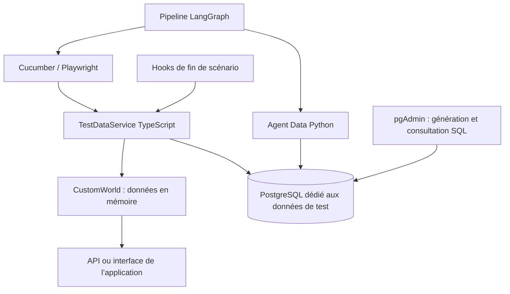

# Agent Data et PostgreSQL

L’agent Data est déterministe : aucune donnée ni requête SQL n’est envoyée au LLM.
Il prépare un run dans PostgreSQL avant le runner Cucumber. Les steps utilisent
`TestDataService`, qui réserve les profils par scénario et transmet les utilisateurs
au client API ou aux Page Objects. `CustomWorld` conserve les mots de passe et les
tokens applicatifs en mémoire, jamais dans les allocations PostgreSQL.

## Installation locale configurée

Une instance séparée du service PostgreSQL existant est créée dans `.qa-test-db/` :

| Paramètre | Valeur |
|---|---|
| Hôte | `127.0.0.1` |
| Port | `5433` |
| Base | `qa_test_data` |
| Compte applicatif | `qa_data` |
| Schéma | `qa_test_data` |
| Authentification | SCRAM-SHA-256 |

Les mots de passe générés sont locaux, sous `.qa-test-db/` (ignoré par Git) et dans
`.env` pour la connexion du framework. Ne pas publier ces fichiers. Le compte
applicatif n’est pas superutilisateur. Aucun paramètre du service existant sur
5432 n’a été modifié. L’instance dédiée écoute uniquement sur la boucle locale.

```powershell
# Démarrer l’instance dédiée après un redémarrage du PC (idempotent)
npm.cmd run data:setup
# Initialiser le schéma et les jeux synthétiques (idempotent)
npm.cmd run data:init
npm.cmd run data:status
# Agent Python
npm.cmd run agents:data -- status
# Pipeline : prepare_data → execute → validate → analyse → report/finalisation
npm.cmd run agents:pipeline -- full
# Vérifications locales avec la vraie base, sans navigateur, API applicative ni LLM
npm.cmd run data:test
```

La configuration active est `TEST_DATA_PROVIDER=postgres`. Pour exécuter les tests
avec les générateurs en mémoire, choisir explicitement `TEST_DATA_PROVIDER=memory`.
Une erreur PostgreSQL en mode postgres ne déclenche pas de fallback en mémoire.
Les migrations sont explicites (`data:init`), pas exécutées automatiquement par
chaque worker du pipeline.

## pgAdmin

Dans pgAdmin, la connexion s’appelle **QA Framework - Test Data (5433)**, sous le
groupe **QA Framework**. Actualiser l’arbre ou relancer pgAdmin si elle n’apparaît
pas immédiatement. La connexion utilise un passfile local, sans mot de passe
dans le fichier JSON d’import. Le script de configuration sauvegarde le profil
pgAdmin avant d’ajouter la connexion ; il ne remplace pas les serveurs existants.

Pour réenregistrer la connexion :

```powershell
python scripts/register-data-pgadmin.py
```

Ouvrir la base → **Query Tool** et charger :

- `database/migrations/001_test_data.sql` : tables, contraintes et index ;
- `database/queries/seed.sql` : 200 profils et 3 cas négatifs générés par SQL ;
- `database/queries/inspect.sql` : consultation des jeux, runs et réservations.

Les cas négatifs email invalide, email vide et mot de passe faible sont consommés
par les steps Signup. Les autres valeurs négatives existantes restent dans leurs
steps ; elles n’ont pas toutes été migrées vers PostgreSQL.

## Isolation et cycle de vie

`test_runs` identifie le run ; `data_sets` conserve les profils synthétiques et
cas négatifs ; `data_allocations` réserve les profils pour chaque scénario.
Les transactions `FOR UPDATE SKIP LOCKED` et l’index unique des réservations
actives empêchent deux workers de réserver le même profil simultanément.
L’email est unique par allocation, même lorsque le profil est réutilisé.

Les hooks libèrent leurs propres réservations. Après un runner terminé, le
pipeline clôture le run. Une interruption laisse des réservations consultables.
Confirmer que le runner est arrêté avant de les libérer explicitement :

```powershell
npm.cmd run data:complete -- --run-id <identifiant-du-run>
```

La libération concerne **uniquement la base de jeux de test**. Elle ne supprime
pas les comptes créés dans l’application : aucun contrat d’API de suppression
n’a été ajouté. `application_state` distingue une création confirmée d’un appel
dont le résultat reste inconnu. Les comptes existants de l’application ne sont
jamais supprimés directement par SQL.

Ne pas recycler automatiquement les réservations selon un délai : un scénario
long ou un runner encore actif pourrait utiliser les données. Pour les exécutions
Cucumber directes, les hooks libèrent les allocations ; clôturer le run est une
action explicite si l’on souhaite aussi renseigner sa date de fin.

## Architecture


